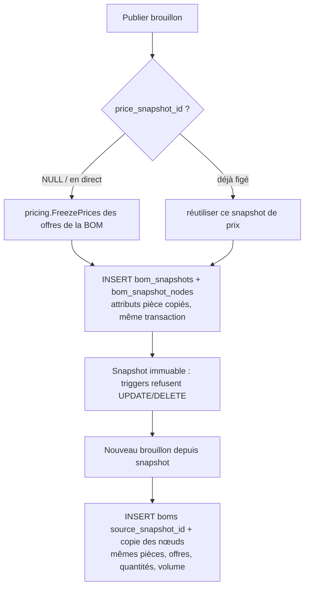

# BOM (C)

## Context

Partie « C » du découpage d'équipe : la BOM s'édite comme un arbre, ses totaux sont justes et rapides,
et elle se publie en snapshot immuable. Le ticket couvre trois features de `docs/features.md` :
`bom-management` (l. 72-91), `bom-tree-editor` (l. 94-121) et `bom-draft-and-snapshots` (l. 167-192).
Il avance en parallèle de NLPF-67 (catalogue, A) et NLPF-68 (prix & devises, B), tous deux à Joe :
la BOM consomme leurs interfaces (`catalog.Catalog`, `pricing.Pricing`) avec des stubs, posées par NLPF-70.

### Décisions prises avec l'humain (2026-11-02)

| # | Question | Choix |
|---|----------|-------|
| D1 | Stockage d'un snapshot de BOM | **Tables relationnelles** (`bom_snapshots`, `bom_snapshot_nodes`) avec triggers `reject_mutation` → ADR 0006 |
| D2 | Attributs pièce (CO2, masse, délai de production) attendus de NLPF-67 | **Étendre `catalog.Part` + `Stub` maintenant**, commit dédié à annoncer à Joe |
| D3 | « Créer un brouillon depuis un snapshot » | **Nouvelle BOM** (copie), avec un lien `source_snapshot_id` vers le snapshot d'origine |
| D4 | Délai d'une feuille | **Livraison de l'offre + production de la pièce** ; sous-ensemble = max(enfants) + ses propres jours de production → ADR 0007 |

Choix par défaut pris par l'agent (à contester en relecture) :
- **Virtualisation de l'arbre faite à la main** (lignes de hauteur fixe, fenêtre visible calculée au scroll) :
  aucune dépendance npm ajoutée (AGENTS §11).
- **Figer les prix** passe par une extension de `pricing.Pricing` (snapshot de prix, ADR 0002) avec stub ;
  l'implémentation base reste à NLPF-68.

## Research Findings

### Relevant Files

| Fichier | Rôle pour ce ticket |
|---------|---------------------|
| `migrations/00001_init.sql` | `boms`, `bom_nodes` (arbre, cascade, racine unique, cohérence offre/pièce), `reject_mutation()`, snapshots de prix. **Ne pas modifier** : on ajoute `00002`. |
| `internal/bom/service.go` | `Service{catalog, pricing}`, `PricedOffer`. À étendre (CRUD, arbre, totaux). |
| `internal/catalog/catalog.go`, `stub.go` | `Part` sans CO2/masse/délai de production → à étendre (D2). |
| `internal/pricing/pricing.go`, `stub.go` | `OfferPrice`, `Rate` (paire exacte, pas d'inversion) ; `ErrNoQuote`, `ErrNoRate`. Ajout des méthodes de snapshot de prix. |
| `internal/money/money.go` | `Money` : `Add` (refuse deux devises), `Mul(decimal)`, `Round()` half-even (ADR 0004), JSON en chaîne. |
| `internal/snapshot/doc.go` | Package vide : publication et lecture des snapshots de BOM. |
| `internal/httpapi/router.go` | Routeur stdlib, `writeJSON` ; seulement `/healthz` aujourd'hui. |
| `cmd/server/main.go` | Câblage ; `httpapi.NewRouter()` sans dépendances pour l'instant. |
| `sqlc.yaml` | Un bloc par domaine (`<domaine>db`), override `numeric → decimal.Decimal`. |
| `internal/pricing/immutability_integration_test.go` | Modèle de test d'intégration Postgres (triggers). |
| `web/src/App.tsx` | Squelette React (19 lignes). |
| `docs/adr/0002-stockage-snapshot-de-prix.md` | Snapshot de prix = en-tête + liens vers cotations immuables, domaine `pricing`. |

### Existing Patterns

- Erreurs métier en sentinelles (`ErrNoQuote`), enveloppées `fmt.Errorf("priced offer %d: %w", id, err)`.
- Domaines accédés par interface + `Stub` en mémoire avec `var _ Iface = (*Stub)(nil)`.
- sqlc par domaine, sous-package `<domaine>db` importé seulement par le domaine.
- Immutabilité garantie en base par `reject_mutation()` (UPDATE/DELETE/TRUNCATE).
- Tests table-driven ; tests d'intégration Postgres rejoués en CI (service Postgres 18).

### Constraints

- Jamais de `float` : quantités `NUMERIC`/`decimal.Decimal`, montants `Money`, CO2 et masse en décimal.
- Conversion **avant** addition, dans la devise de référence de la BOM, avec le taux et sa date
  conservés dans l'explication ; arrondi uniquement en sortie (ADR 0004).
- Pas d'inversion de taux dans ce ticket : `pricing.Rate` donne la paire exacte. L'inversion
  (multi-currency-costing) relève de NLPF-68 ; une paire absente remonte `ErrNoRate`, jamais ignorée.
- Recalcul de 30 000 nœuds < 1 s : chargement de l'arbre en **une** requête, prix récupérés une fois
  par offre distincte, calcul en mémoire en O(n) (parcours post-ordre, pas de récursion SQL par nœud).
- Déterminisme : enfants triés par `id`, pas d'itération sur une map Go pour produire un résultat.
- Cycle : contrôle par CTE récursive **dans la même transaction** que l'`UPDATE parent_id`.

```
boms (brouillon = boms + bom_nodes)            bom_snapshots (immuable)
 ├─ currency, volume                             ├─ bom_id  (FK, pas de cascade → bloque DELETE boms)
 ├─ price_snapshot_id NULL = prix en direct      ├─ price_snapshot_id (NOT NULL)
 ├─ source_snapshot_id NULL                      ├─ currency, volume, name, published_at
 └─ bom_nodes (arbre)                            └─ bom_snapshot_nodes
      ├─ parent_id, quantity                          ├─ node_key, parent_key, quantity, name
      ├─ part_id/offer_id | name                      ├─ part_id, offer_id
      └─ production_days (sous-ensemble)              └─ co2_kg, mass_kg, production_days,
                                                        lead_time_days (copiés)
```



## Requirements

### Must Have
- **R1** Créer, lister, renommer une BOM ; une BOM créée a une racine, une devise de référence et un volume ;
  devise et volume modifiables sur le brouillon.
- **R2** Supprimer une BOM sans snapshot ; refus (`ErrHasSnapshots`, HTTP 409) si un snapshot existe.
- **R3** Ajouter une pièce sous un nœud avec l'offre et la quantité choisies par l'utilisateur ;
  ajouter un sous-ensemble ; changer l'offre d'une pièce.
- **R4** Déplacer un nœud ; refus `ErrCycle` si le nouveau parent est le nœud ou un de ses descendants.
- **R5** Supprimer un nœud supprime son sous-arbre ; les totaux recalculés en tiennent compte. La racine ne se supprime pas.
- **R6** Totaux par nœud calculés en Go : quantités multipliées le long du chemin ; coût converti dans la
  devise de la BOM puis additionné ; CO2 sommé ; délai = max(enfants) + production du nœud, feuille =
  livraison + production (D4). Exemples du ticket : 4 × 100 € → +400 € sur tous les parents ;
  4 roues × 5 écrous → 20 écrous / 20 € ; 2 j + 30 j → 32 j ; 100 € + 100 USD (0,92) → 192,00 €.
- **R7** Chaque total dit sur quoi il repose : prix en direct ou snapshot de prix, taux utilisés et leur date,
  devise. Prix ou taux manquant → erreur nommée sur le nœud, jamais zéro.
- **R8** Benchmark Go : recalcul d'une BOM de 30 000 nœuds < 1 s.
- **R9** Figer les prix d'un brouillon (crée un snapshot de prix et l'attache) et le remettre en direct ;
  une fois figés, les totaux ne bougent plus à l'arrivée de nouvelles cotations.
- **R10** Publier un brouillon crée un snapshot de BOM immuable (structure, quantités, offres, attributs
  pièce, volume, devise, snapshot de prix). La base refuse `UPDATE`/`DELETE` ; modifier le CO2 d'une
  pièce ensuite ne change pas le snapshot.
- **R11** Créer un brouillon (nouvelle BOM, D3) depuis un snapshot : mêmes pièces, offres, quantités, volume.
- **R12** UI : liste des BOM, arbre virtualisé, panneau latéral de détail, changement d'offre en un geste,
  ajout / déplacement / suppression (avec confirmation) ; couleurs via `--ok`/`--warn`/`--over`.
- **R13** ADR rédigées (statut `Proposé`) pour D1 et D4.

### Should Have
- **S1** Quantités commandées (quantité réelle × volume) affichées dans le panneau latéral.
- **S2** Lecture d'un snapshot publié dans l'UI (arbre en lecture seule).

### Won't Do
- Inversion de taux / conversion par devise pivot (NLPF-68).
- Implémentation base de `FreezePrices` / prix d'un snapshot de prix (NLPF-68) : stub seulement ici.
- Implémentation base des nouveaux attributs pièce, archivage des pièces (NLPF-67).
- Contrats, remises, budgets dans le snapshot (features pas encore livrées) ; la structure les accueillera par une migration future.
- Glisser-déposer, annuler/refaire, comparaison de snapshots, export CSV/PDF.
- Temps réel SSE dans l'arbre (ADR 0003, NLPF-68) : rafraîchissement à l'action pour l'instant.

## Tasks

- [x] T1: ADR 0006 (stockage snapshot de BOM) et ADR 0007 (règles de calcul des totaux)
  - **Files**: `docs/adr/0006-stockage-snapshot-de-bom.md`, `docs/adr/0007-calcul-des-totaux-bom.md`
  - **Approach**: Rédiger au format AGENTS §8, statut `Proposé`. 0006 : tables relationnelles vs JSONB (D1),
    blocage du DELETE de BOM par FK, impact pivot (carbone versionné). 0007 : quantités multipliées, conversion
    avant somme, délai feuille = livraison + production (D4), arrondi en sortie seulement, erreurs nommées.
  - **Done when**: les deux fichiers existent au statut `Proposé` ; **un humain les accepte avant T3**.

- [x] T2: Étendre `catalog.Part` et `pricing.Pricing` (+ stubs)
  - **Files**: `internal/catalog/catalog.go`, `internal/catalog/stub.go`, `internal/catalog/stub_test.go`,
    `internal/pricing/pricing.go`, `internal/pricing/stub.go`, `internal/pricing/stub_test.go`
  - **Approach**: `Part` gagne `CO2Kg`, `MassKg` (`decimal.Decimal`) et `ProductionDays int` (D2).
    `Pricing` gagne `FreezePrices(ctx, offerIDs, currencies, at) (int64, error)`, `SnapshotOfferPrice(ctx, snapID, offerID)`
    et `SnapshotRate(ctx, snapID, from, to)` ; le stub copie les cotations courantes. Commit isolé, annoncé à Joe.
  - **Done when**: `go test ./internal/catalog/... ./internal/pricing/...` passe ; un test prouve qu'une
    cotation ajoutée après `FreezePrices` ne change pas `SnapshotOfferPrice`.

- [x] T3: Migration 00002 — colonnes brouillon et tables de snapshot de BOM
  - **Files**: `migrations/00002_bom_snapshots.sql`, `internal/snapshot/immutability_integration_test.go`
  - **Approach**: `bom_nodes.production_days INTEGER NOT NULL DEFAULT 0 CHECK (>= 0)` ; `boms.price_snapshot_id`
    et `boms.source_snapshot_id` (nullables) ; `bom_snapshots` (FK `bom_id` **sans** cascade) et
    `bom_snapshot_nodes` (attributs copiés, `NUMERIC`), triggers `reject_mutation` UPDATE/DELETE/TRUNCATE (ADR 0006).
  - **Done when**: `goose up/reset/up` passe ; le test d'intégration montre `UPDATE`/`DELETE` refusés sur les
    deux tables et `DELETE FROM boms` refusé quand un snapshot existe.

- [x] T4: Accès données BOM (sqlc) et opérations d'arbre
  - **Files**: `internal/bom/queries.sql`, `internal/bom/bomdb/*` (généré), `sqlc.yaml`, `internal/bom/store.go`,
    `internal/bom/store_integration_test.go`
  - **Approach**: Requêtes : créer BOM + racine (une transaction), lister, renommer, réglages, supprimer,
    charger tout l'arbre en une requête, ajouter nœud, changer offre, supprimer nœud (cascade existante),
    déplacer : CTE récursive des descendants puis `UPDATE` dans la même transaction → `ErrCycle`.
  - **Done when**: tests d'intégration : déplacement sous un descendant → `errors.Is(err, ErrCycle)` ;
    suppression d'un sous-ensemble supprime ses enfants ; suppression de la racine refusée.

- [x] T5: Calcul des totaux en Go (pur, sans base) + benchmark
  - **Files**: `internal/bom/totals.go`, `internal/bom/totals_test.go`, `internal/bom/totals_bench_test.go`
  - **Approach**: `ComputeTotals(tree, prices, rates, currency)` : parcours post-ordre itératif, enfants triés par id,
    quantité réelle = produit du chemin, coût converti puis additionné (`money.Add`), CO2 sommé, délai selon ADR 0007 ;
    chaque nœud porte son explication (source des prix, taux + date) ou une erreur nommée.
  - **Done when**: tests table-driven verts pour les 4 exemples de R6, prix manquant (`ErrNoQuote`) et taux
    manquant (`ErrNoRate`) remontés sur le nœud ; `go test -bench Totals30k` < 1 s/op et un test garde-fou
    échoue au-delà.

- [x] T6: Service BOM — CRUD, arbre, prix en direct ou figés, totaux
  - **Files**: `internal/bom/service.go`, `internal/bom/service_test.go`
  - **Approach**: Le service orchestre store + catalog + pricing : valide (offre de la bonne pièce, quantité > 0,
    devise ISO), récupère une fois chaque offre/taux distinct (en direct ou via `price_snapshot_id`), appelle
    `ComputeTotals`. `FreezePrices` / `UnfreezePrices` sur le brouillon ; `Delete` → `ErrHasSnapshots`.
  - **Done when**: tests : totaux identiques avant/après une nouvelle cotation quand les prix sont figés, et
    différents en direct ; `ErrHasSnapshots` sur suppression ; ajout d'une offre d'une autre pièce refusé.

- [ ] T7: Domaine snapshot — publier, lire, nouveau brouillon
  - **Files**: `internal/snapshot/snapshot.go`, `internal/snapshot/queries.sql`, `internal/snapshot/snapshotdb/*`,
    `sqlc.yaml`, `internal/snapshot/snapshot_integration_test.go`
  - **Approach**: `Publish` : snapshot de prix réutilisé ou créé (`FreezePrices`), copie nœuds + attributs pièce
    dans une transaction. `Get` : lit l'arbre figé et calcule ses totaux avec ses propres attributs et prix.
    `NewDraft` : nouvelle BOM avec `source_snapshot_id` et copie des nœuds (D3), créée **via `bom.Service`**
    (`snapshot` dépend de `bom`, jamais l'inverse ; `snapshot` n'écrit que ses propres tables). Aucune méthode de modification.
  - **Done when**: tests : CO2 de la pièce modifié après publication → totaux du snapshot inchangés ;
    brouillon depuis snapshot = mêmes pièces, offres, quantités, volume.

- [ ] T8: API HTTP `/api/v1/boms` et câblage
  - **Files**: `internal/httpapi/router.go`, `internal/httpapi/boms.go`, `internal/httpapi/boms_test.go`, `cmd/server/main.go`
  - **Approach**: Handlers fins : `GET/POST /api/v1/boms`, `PATCH|DELETE /api/v1/boms/{id}`, `GET /api/v1/boms/{id}/tree`
    (nœuds + totaux), `POST /nodes`, `PATCH|DELETE /nodes/{nodeID}` (offre, quantité, parent), `POST /freeze-prices`,
    `DELETE /freeze-prices`, `POST /publish`, `GET /api/v1/snapshots/{id}`, `POST /api/v1/snapshots/{id}/drafts`.
    Mapping erreurs : `ErrCycle`/`ErrHasSnapshots` → 409, not found → 404, validation → 400, `{"error": ...}`.
  - **Done when**: tests `httptest` table-driven verts sur chaque route et chaque code d'erreur ; montants en chaîne.

- [ ] T9: UI — liste des BOM, arbre virtualisé, panneau latéral
  - **Files**: `web/src/App.tsx`, `web/src/api.ts`, `web/src/bom/BomList.tsx`, `web/src/bom/BomTree.tsx`,
    `web/src/bom/NodePanel.tsx`, `web/src/money.ts`, `web/src/index.css`
  - **Approach**: Arbre aplati en lignes de hauteur fixe, seules les lignes visibles rendues (virtualisation maison,
    sans dépendance) ; panneau latéral (totaux, explication, quantités × volume) ; `<select>` d'offre qui envoie le
    PATCH au changement (un geste) ; ajouter, déplacer (choix du parent), supprimer avec confirmation ; montants
    formatés par `Intl.NumberFormat` depuis la chaîne.
  - **Done when**: `npm run build` et `oxlint` passent ; vérification manuelle sur une BOM de 30 000 nœuds générée
    (scroll fluide, < 100 lignes dans le DOM) et changement d'offre qui met à jour les totaux.

## Verification

### Automated Checks
- `make lint` (golangci-lint + gosec), `make test` (dont tests d'intégration Postgres)
- `go test -bench Totals30k -run '^$' ./internal/bom/`
- `make sqlc` puis `git diff --exit-code` (code généré à jour)
- `cd web && npm ci && npx oxlint && npm run build`
- CI verte sur la PR

### Manual Checks
- `make dev` : créer une BOM, ajouter « Roues » (2 j de production) puis une pièce à 100 € × 4 dessous, vérifier +400 € sur la racine.
- Déplacer un nœud sous son enfant : message d'erreur explicite, arbre inchangé.
- Figer les prix, attendre de nouvelles cotations du simulateur : totaux inchangés.
- Publier, tenter `UPDATE bom_snapshot_nodes ...` en `psql` : refus.

### Acceptance Criteria
- [ ] Une BOM créée a une racine, une devise et un volume ; sa suppression est refusée si un snapshot existe (R1, R2)
- [ ] Une pièce s'ajoute sous un nœud avec l'offre et la quantité choisies (R3)
- [ ] Déplacer un nœud sous l'un de ses descendants est refusé (`ErrCycle`) (R4)
- [ ] Supprimer un sous-ensemble supprime ses enfants et recalcule les totaux (R5)
- [ ] 4 × 100 € → +400 € sur tous les parents ; 4 roues × 5 écrous → 20 écrous ; 2 j + 30 j → 32 j ; 100 € + 100 USD → 192,00 € (R6, R7)
- [ ] L'arbre est virtualisé, a un panneau latéral, et on change d'offre en un geste (R12)
- [ ] Le recalcul d'une BOM de 30 000 nœuds prend moins d'1 s (benchmark Go) (R8)
- [ ] Une fois les prix figés, les totaux ne bougent plus (R9)
- [ ] Un snapshot publié est refusé en `UPDATE`/`DELETE` par la base, et ne change pas si on modifie le CO2 d'une pièce (R10)
- [ ] Un brouillon créé depuis un snapshot a les mêmes pièces, offres, quantités et le même volume (R11)
- [ ] ADR 0006 et 0007 rédigées, acceptées par un humain avant le code qui les implémente (R13)
