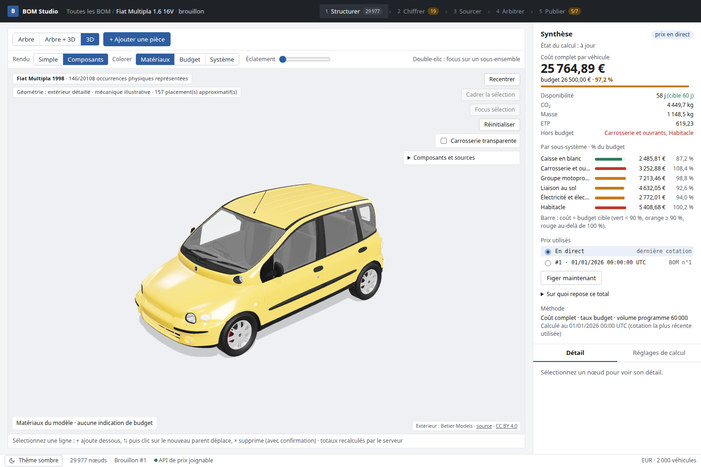
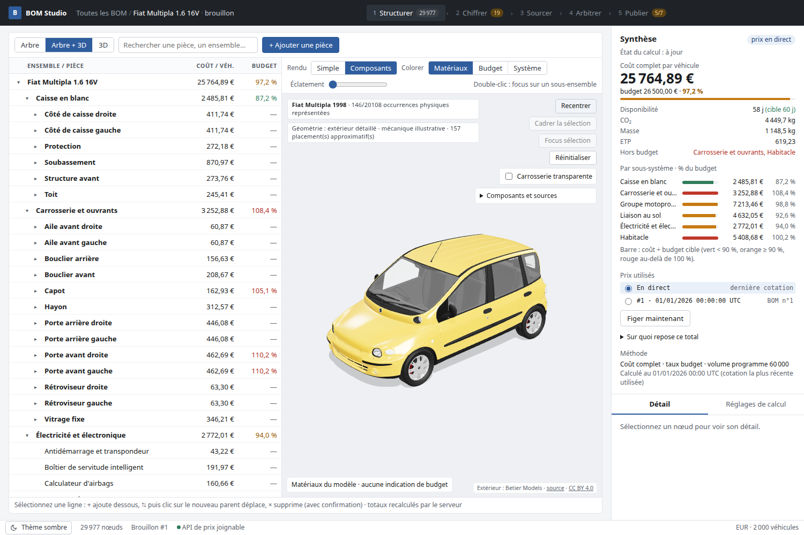
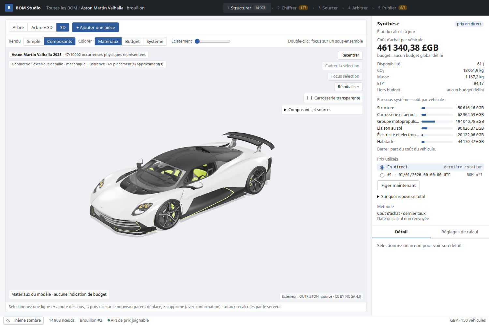
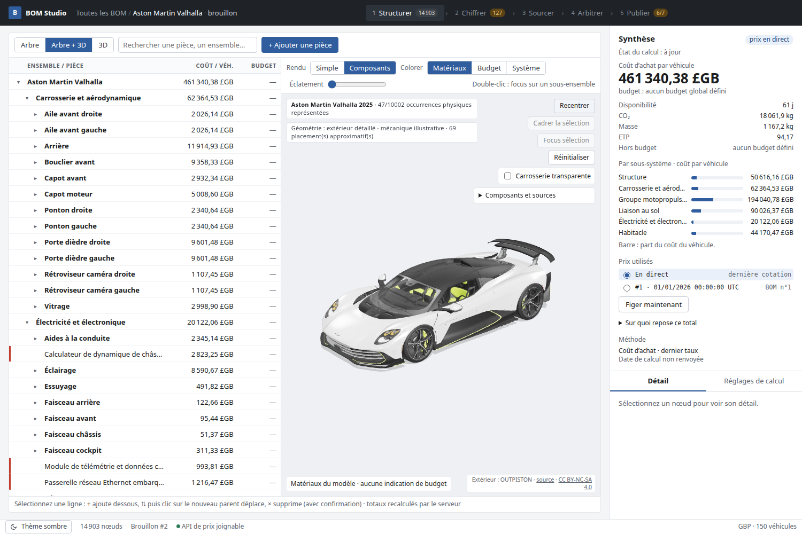

# Captures après les corrections finales

Captures réelles de l'application avec les modèles fournis et l'API Go locale. Le sélecteur Réaliste
est absent ; les vues 3D et Arbre + 3D sont conservées. Les extérieurs ne sont pas remplacés.

| Véhicule | 3D | Arbre + 3D |
|---|---|---|
| Fiat Multipla |  |  |
| Aston Martin Valhalla |  |  |

- Éclatés : [Fiat](multipla-exploded.png), [Aston](valhalla-exploded.png).
- Sélection BOM : [Fiat](multipla-selection-bom.png), [Aston](valhalla-selection-bom.png).
- Clic 3D : [Fiat](multipla-selection-3d.png), [Aston](valhalla-selection-3d.png).
- Deux arbres à cames liés : [occurrence #12932, quantité deux](multipla-arbres-a-cames-repares.png).
- Pièce absente, groupe localisé explicitement : [Fiat](multipla-localisation-sous-ensemble.png),
  [Aston](valhalla-localisation-sous-ensemble.png). L'ID BOM reste celui de la pièce absente.
- Motorisation Valhalla : [thermique](valhalla-thermal.png), [électrique](valhalla-electric.png),
  [hybride](valhalla-hybrid.png).
- Batterie de démonstration : [50 Ah](battery-50ah-illustrative.png), [60 Ah](battery-60ah-illustrative.png).

Rapport du parcours : [validation.json](validation.json). Les données de la BOM sont celles du jeu
de démonstration. Intérieurs, placements et batterie de remplacement **illustratifs**, sans exactitude
constructeur revendiquée. Fiat © Betier Models, CC BY 4.0 ; Aston © OUTPISTON, CC BY-NC-SA 4.0.
Sources et transformations : [SOUTENANCE_ASSETS.md](../../SOUTENANCE_ASSETS.md).
