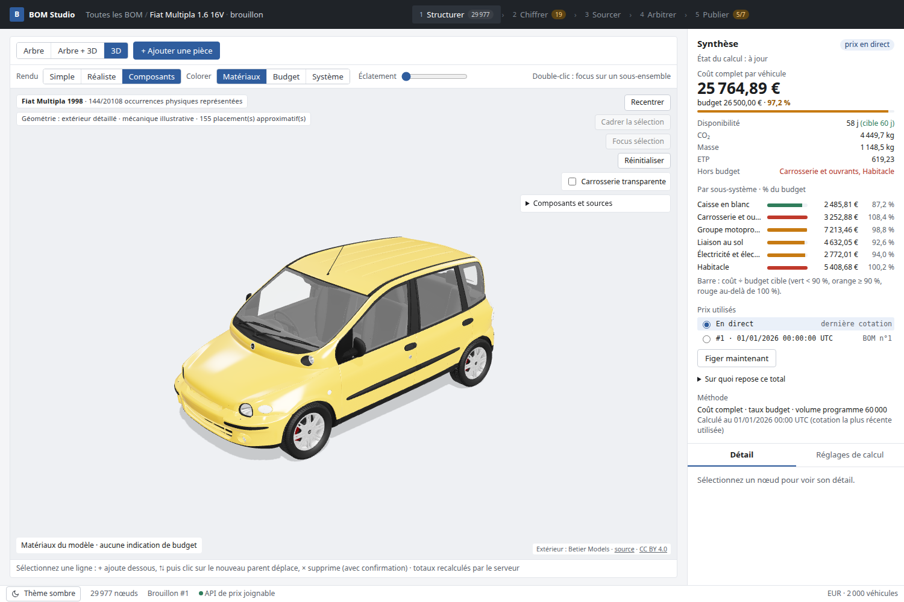
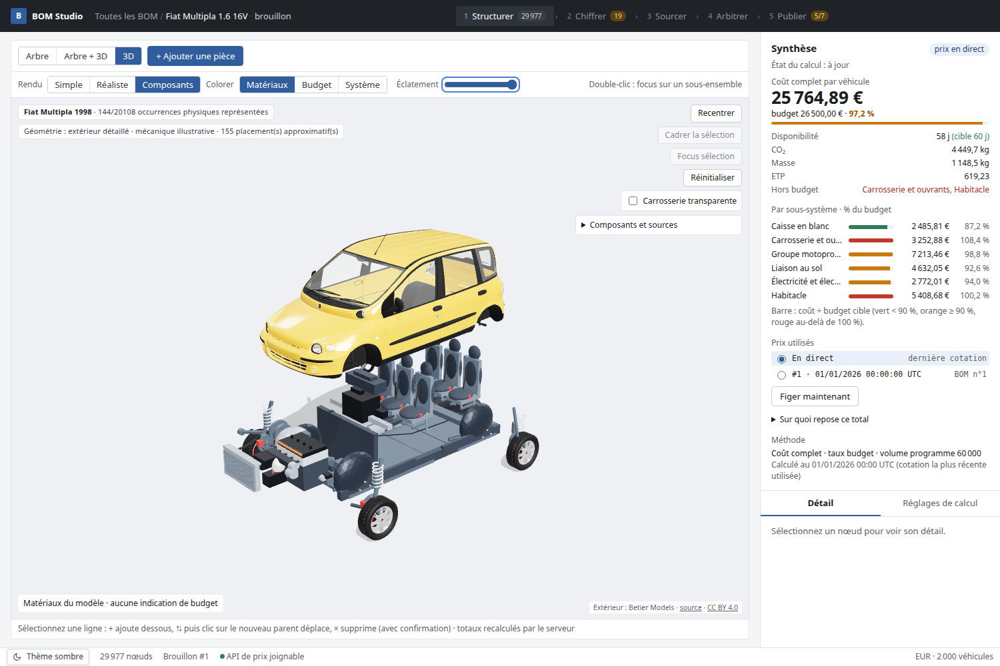
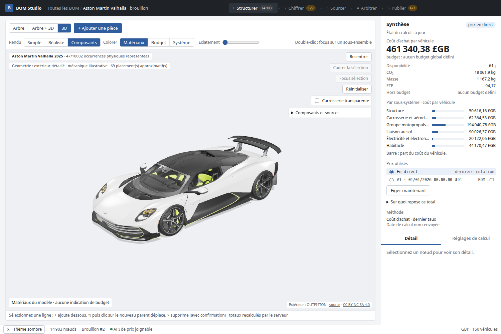
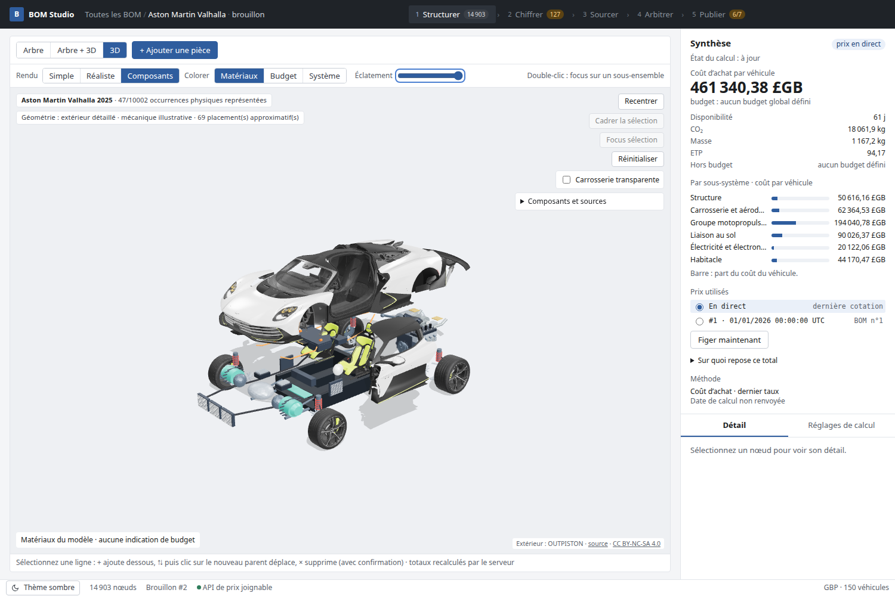

# Captures réelles — application de soutenance

Captures Chromium de l'application complète avec les GLB fournis et l'API Go locale, sans images
générées. Résultat du parcours : [validation.json](validation.json), zéro erreur. Les métadonnées
chiffrées de la BOM sont celles du jeu de démonstration, pas des données industrielles constructeur.

| | Assemblée | Éclatée |
|---|---|---|
| Fiat |  |  |
| Aston |  |  |

- Étapes à 50 % : [Fiat](multipla-exploded-half.png), [Aston](valhalla-exploded-half.png).
- Sélection BOM → 3D : [Fiat](multipla-selection-bom.png), [Aston](valhalla-selection-bom.png).
- Clic réel 3D → BOM : [Fiat](multipla-selection-3d.png), [Aston](valhalla-selection-3d.png).
- Focus de groupe : [Fiat](multipla-group-focus.png), [Aston](valhalla-group-focus.png).
- Motorisation : [thermique](valhalla-thermal.png), [électrique](valhalla-electric.png), [hybride](valhalla-hybrid.png).
- Remplacement illustratif de batterie : [50 Ah](battery-50ah-illustrative.png), [60 Ah](battery-60ah-illustrative.png).

Les intérieurs et la variante de boîtier sont **illustratifs** ; les placements ne sont pas certifiés.
Crédits des extérieurs : Fiat © Betier Models, CC BY 4.0 ; Aston © OUTPISTON, CC BY-NC-SA 4.0.
Sources et transformations : [SOUTENANCE_ASSETS.md](../../SOUTENANCE_ASSETS.md).
