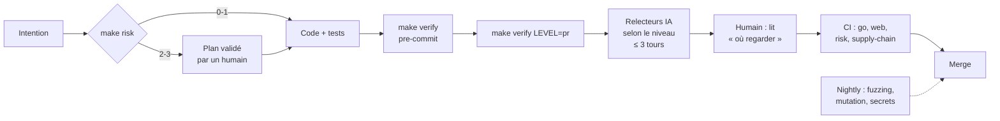

# L'usine logicielle de BOM Studio (harnais V2)

> **L'IA produit, l'humain garantit.** Le harnais fait en sorte que l'humain garantisse
> **ce qui compte** au lieu de tout relire avec la même (faible) attention.

Branche `v2-harnais`. Décisions : ADR 0039 (capteurs calculés) et ADR 0040 (guides et relecture IA),
au statut `Proposé`. Repris de nos projets `3-Istor/expense-io` et `3-Istor/sdi-harness`, adapté à Go + React.

## 1. Le problème, en une slide

- Les agents écrivent l'essentiel du code (V2 : 7 lots en parallèle, ~90 commits d'agent).
- Avant : une CI binaire (vert/rouge), des règles d'architecture **écrites** mais vérifiées à l'œil,
  un `AGENTS.md` de 229 lignes, une relecture humaine uniforme.
- Risque : un `float` dans un montant ou un snapshot modifié passe la CI et se voit en soutenance.

## 2. Le cadre : guides et capteurs

D'après Böckeler (Thoughtworks, *Harness engineering*, 2026), déjà appliqué dans expense-io :

| | **Calculé** (déterministe, rapide, gratuit) | **Inféré** (un modèle juge) |
|---|---|---|
| **Guide** (avant l'action) | `.claude/settings.json`, hooks qui bloquent, `make risk` | `AGENTS.md` (carte), 7 skills, `REVIEW.md` |
| **Capteur** (après l'action) | tests d'architecture, contrat des routes, fuzzing, mutation, gitleaks, osv-scanner, gosec | 4 relecteurs IA en contexte neuf |

Deux règles : **le calculé d'abord** (un relecteur IA ne rend jamais vert ce que la moulinette refuse) ;
**le rapide en local, le coûteux la nuit** (la CI confirme, elle ne découvre pas).

## 3. Le flux d'un changement

## 4. Niveaux de risque (calculés, pas déclarés)

`go run ./cmd/risk` lit le diff git et applique une table unique (`cmd/risk/rules.go`).
Le niveau vient **du changement, jamais de l'auteur** (Anthropic, oct. 2026).

| Niveau | Exemples | Humain | Relecteurs IA |
|---|---|---|---|
| 0 Cosmétique | doc, CSS, captures | aucun | — |
| 1 Routine | un domaine, un écran, un test ajouté | lit le résumé de preuves | code |
| 2 Sensible | migration, contrat `/api/v1`, 2 domaines, dépendance, ADR | valide le plan **avant** | + architecture |
| 3 Critique | `money`, `snapshot`, calcul du coût, le harnais lui-même, **test supprimé ou désactivé** | 2 humains dont un CODEOWNER | + sécurité, + métier |

Exemple réel : le diff de cette branche sort au niveau 3 (il touche `.github/` et `AGENTS.md`).

## 5. Les capteurs calculés, par étage

| Étage | Durée | Contrôles |
|---|---|---|
| **pre-commit** (`make verify`) | < 1 min | gofmt, vet, frontières d'architecture, contrat des routes, table des niveaux ↔ doc, gitleaks sur l'index, oxlint |
| **avant push** (`LEVEL=pr`) | ~ CI | + tidy, sqlc, golangci-lint (gosec), tests `-race` (+ intégration si base), govulncheck, osv-scanner, actionlint, tests et build web, npm audit |
| **CI** (chaque PR) | | jobs existants + `risk` (niveau dans le résumé de la PR) + `supply-chain` (gitleaks sur les commits de la PR, osv-scanner, actionlint, SBOM CycloneDX Go et web) |
| **nightly** | ~ 30 min | fuzzing `FuzzParse` (montants), mutation `money` (cliquet ≥ 80 %) et `bom`, gitleaks sur tout l'historique, intégration PostgreSQL |

Chaque étape finit `passed`, `failed` ou **`not_run` avec la raison** : une étape non lancée n'est jamais
comptée verte (repris de sdi-harness). Résumé lisible : `.verify/verify-summary.md`.

### Ce que les tests d'architecture vérifient (`internal/archtest`, 0,2 s)

- un domaine n'importe ni `net/http`, ni pgx, ni un adapter, ni `math/rand`, ni un SDK d'IA ;
- `money` ne dépend d'aucun domaine ; un handler n'accède jamais à la base ;
- **aucun `float32`/`float64`** ni `strconv.ParseFloat` dans le code de production ;
- **aucun `time.Now`** dans un domaine (reproductibilité) ;
- la doc des agents ne ment pas : chemins cités existants, skills ≤ 100 lignes et listées,
  relecteurs sans droit d'écriture, `AGENTS.md` ≤ 120 lignes.

Chaque règle a été **prouvée capable d'échouer** (violation plantée, test rouge, violation retirée).

## 6. La relecture IA : quatre axes, et un routage vers l'humain

`REVIEW.md`, aligné sur Claude Code Review (Important / Nit / Pré-existant) et enrichi de trois axes :

| Axe | Valeurs |
|---|---|
| Sévérité | Important · Nit · Pré-existant |
| Domaine | métier · sécurité · contrat · architecture · correction · tests |
| Confiance | vérifiée (test, commande) · probable (chemin cité) · spéculative |
| Impact | données · utilisateur · interne |

**Ce qui arrive à l'humain** : `Important` vérifié ou probable (bloque) ; tout constat métier ou sécurité au
niveau ≥ 2. Les `Nit` tiennent en une ligne, les `Pré-existant` partent en ticket, le spéculatif est jeté.
**3 tours au plus**, puis on revoit l'approche (chez Anthropic : PR à 5 tours ou plus passées de 8,9 % à 1,5 %).

Relecteurs (`.claude/agents/`) : **code**, **architecture**, **sécurité**, **métier** — lecture seule,
**contexte neuf** (ils ne voient ni la conversation ni le plan, seulement le diff), constats prouvés.
En CI : `ai-review.yml` lance les mêmes relecteurs sur la PR, inerte tant que `ANTHROPIC_API_KEY` n'est pas défini.

## 7. Les guides

- **`AGENTS.md` = une carte de 104 lignes** (risque, commandes, carte du dépôt, règles, interdits, boucle,
  skills). Le texte d'origine est conservé mot pour mot dans `docs/agents/`.
- **7 skills courtes (43 à 62 lignes)**, le format Agent Skills (nom + description chargés d'abord, corps à la
  demande) : `ajouter-feature`, `changer-contrat-api`, `ajouter-migration`, `rediger-adr`,
  `revue-par-niveau`, `trier-constat`, `audit-securite` (méthode en 6 phases de Cloudflare, constats
  vérifiés par un agent distinct de celui qui les trouve).
- **Hooks qui bloquent** (Claude Code) : éditer une migration commitée, une ADR acceptée,
  `docs/features.md` ou un `.env` ; `push --force`, push vers `main`, `commit --no-verify`, `npm install`,
  `go get`, toucher aux snapshots publiés. Un rappel du niveau de risque à chaque fin de tour.
- **Git** : `pre-commit` = moulinette rapide ; `commit-msg` refuse un commit d'agent sans `Co-Authored-By`.

## 8. Mesures (17/11/2026, sur `v2-harnais`)

| Mesure | Valeur |
|---|---|
| Routes `/api/v1` figées dans le contrat | 80 |
| Secrets dans l'historique (gitleaks, 254 commits) | 0 |
| Vulnérabilités connues Go + npm (osv-scanner, govulncheck) | 0 |
| Fuzzing des montants, 40 s | 1,7 million d'entrées, 0 invariant cassé |
| Mutation `internal/money` (gremlins) | 83,9 % des mutants tués (26/31) |
| SBOM | 297 composants Go, 4 npm de production |
| Durée des tests d'architecture | 0,2 s |

## 9. Ce qu'on a repris, adapté, laissé

| Idée (source) | Dans STP |
|---|---|
| Moulinette à niveaux, cliquets (expense-io) | `scripts/verify.sh fast|pr|nightly`, cliquet de mutation |
| Niveaux de risque 0–3 (expense-io), autonomie par paliers (sdi-harness) | `cmd/risk` en Go, testé, table unique |
| `not_run` honnête, outils épinglés (sdi-harness) | statut par étape, `scripts/tools.env` |
| Relecteurs en contexte neuf (expense-io) | 4 relecteurs dont un **métier** propre à la BOM |
| dependency-cruiser, Stryker, Semgrep (expense-io, TypeScript) | remplacés par `archtest` (Go natif), gremlins, gosec |
| Scorecard, dependency-review | **laissés** : demandent un dépôt public ou GitHub Advanced Security |

## 10. Limites, dites honnêtement

- La CI ne tourne que sur `main` et les PR : les nouveaux jobs n'ont pas encore tourné sur GitHub.
- La relecture IA en CI demande une clé API (coût) ; sans elle, elle se fait en local par la skill.
- Les identifiants GitHub de `CODEOWNERS` sont déduits de l'historique : Joe et new1901 à ajouter.
- Les niveaux de risque sont des chemins : un bug métier dans un fichier « routine » reste possible,
  d'où les tests d'architecture et le relecteur métier.
- La mutation de `bom` est mesurée sans seuil (premier passage à faire tourner en nightly).

## Sources

- Anthropic, *How the Claude Code team does code review*, 15/10/2026 (niveaux, 3 tours, sévérités) — résumé :
  [Developers Digest](https://www.developersdigest.tech/blog/claude-code-team-code-review-risk-tiers-2026)
- [Claude Code Review — documentation](https://code.claude.com/docs/en/code-review) (Important / Nit / Pré-existant, `REVIEW.md`)
- [Anthropic — Skill authoring best practices](https://platform.claude.com/docs/en/agents-and-tools/agent-skills/best-practices)
- [Agent Skills — best practices](https://agentskills.io/skill-creation/best-practices.md)
- [cloudflare/security-audit-skill](https://github.com/cloudflare/security-audit-skill) (MIT, méthode en 6 phases)
- Böckeler, *Harness engineering for coding agents*, martinfowler.com, avril 2026 (cité par le docs/harness.md d'expense-io)
- `3-Istor/expense-io` (son docs/harness.md et son dossier verify/), `3-Istor/sdi-harness` (doctrine/conventions/gates.md, decision-autonomy.md)
